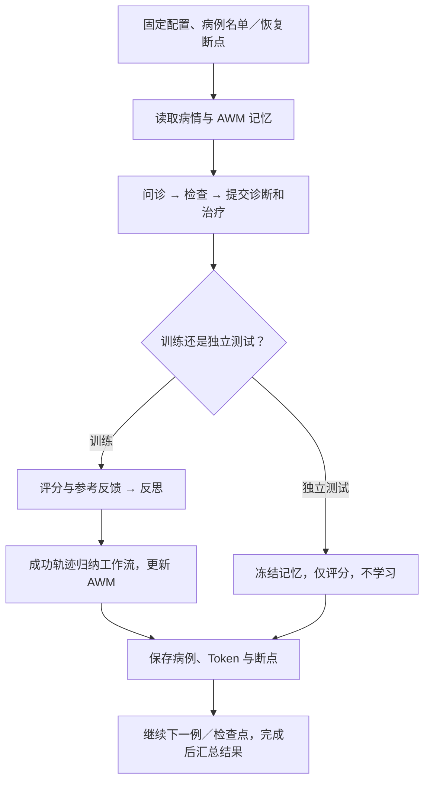
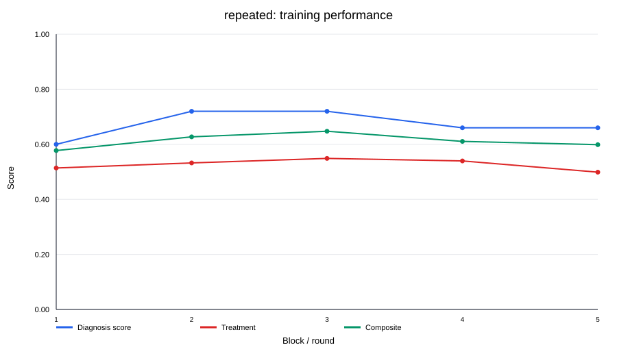
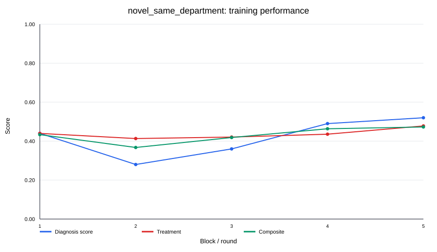
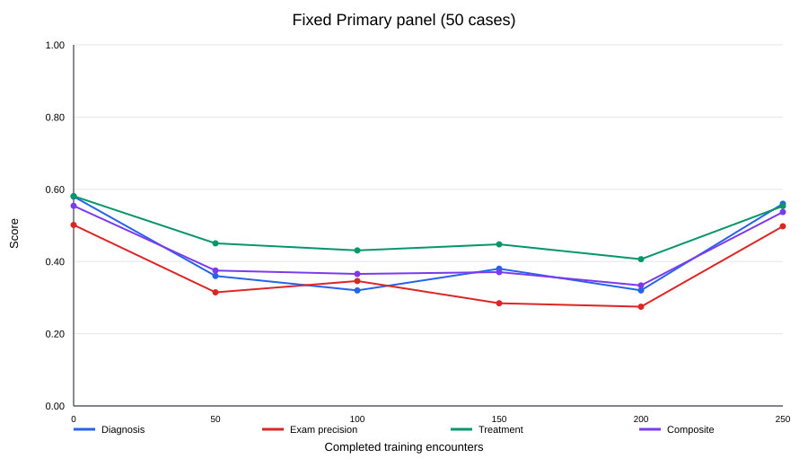

# OpenHospital RSI 阶段汇报

2026-10-29｜首轮 AWM 实验已完成

**当前进展：已跑通三组连续诊疗与记忆学习实验，共 1,100 次诊疗。使用 `qwen3.5-flash`，记忆方法为 AWM 医学适配版；据本轮实际费用反馈，总花费约 43 元。初步看到重复病例和同科新病例上的局部改善，跨科整体增益及 Token 节省尚未得到验证。**

## 1. 测评数据介绍

OpenHospital 以患者资料驱动模拟问诊，提供参考诊断、必要检查及治疗方案用于评分。原始数据分为 Train 10,000 人、Primary 1,000 人、Advanced 1,000 人；不同患者可能患同一种病，也包含多诊断病例。

本轮选取血液科及呼吸内科、消化内科、内分泌科、神经内科。血液科适合首轮经验积累验证：严格单科训练患者有 **448 人、22 个原始疾病标签**，所选 250 个新患者覆盖这 22 个标签。

## 2. 测评实验方案介绍

AWM 将成功诊疗轨迹归纳为可复用的问诊、检查和决策工作流，后续医生调用工作流辅助诊疗。模型权重不变，三个实验的记忆独立。训练每例结束后评分、反思和学习；测试冻结记忆。

| 实验      | 设计与目的                                      | 次数  |
| ------- | ------------------------------------------ | ---:|
| 一：重复病例  | 血液科同一批 50 人重复 5 轮，观察熟悉病例后是否更准确、更省 Token    | 250 |
| 二：同科新病例 | 血液科 250 个不同患者，5 块×50 人，观察经验能否迁移到未见患者       | 250 |
| 三：跨科新病例 | 血液→呼吸→消化→内分泌→神经，每科训练 50 人；在固定五科测试面板观察迁移与遗忘 | 600 |

实验三在训练 0/50/100/150/200/250 人后各做 Primary 50 人，最终做 Advanced 50 人，均为五科各 10 人。前两组无额外测试，使用逐例学习前的诊疗评分比较区块。

**指标：**诊断均分与严格全对率、检查精确率和召回率、治疗分（安全／有效性对齐／个体化）、综合分，以及医生／记忆／全链路每例 Token。综合分为诊断、检查精确率、治疗分的等权平均。

## 3. 测评代码逻辑介绍

入口脚本负责启动与恢复；`streams.py` 管病例计划，`execution.py` 管诊疗与历史记录复用，`experience.py` 管训练／测试调度和快照，AWM 模块管工作流归纳。已具备断点恢复、有限网络重试及格式修复；已保存病例可复用。

## 4. 初步实验结果

### 实验一：重复病例——中期改善，后期回落

首末轮诊断正确人数 **30/50→33/50**，第二、三轮达到 36/50。综合分 **0.577→0.599**，改善不持续；医生 Token/例 **26,874→28,872（+7.4%）**，未观察到明显节省。

### 实验二：同科新病例——后期回升，尚需排除难度差异

首末块诊断均分 **44%→52%**，综合分 **0.433→0.473**，有后期迁移迹象，但各块患者不同、难度可能不同。医生 Token/例 **18,556→24,199（+30.4%）**。多诊断病例允许部分得分，诊断均分不等同于严格全对率。

### 实验三：跨科新病例——最终未超过固定测试基线

Primary 诊断均分 **58%→56%**，综合分 **0.554→0.537**；中途退化、末期回升，尚无整体正向迁移证据。Advanced 最终诊断均分 **0.350**、严格全对率 **32%**、综合分 **0.464**；没有 Advanced 前测，不能计算其增益。

**费用与效率：**全轮已知用量约 **8,847 万 Token**，有 15 次请求失败且缺少用量；约 **43 元**为实际费用反馈。上述 Token 已合并续跑历史，属于已知用量。记忆归纳占实验一、二已知消耗的 **78.6%、55.3%**，下一轮应优先控制记忆更新与注入成本。

## 5. 疑问与待确认点

1. **是否增加“训练后统一测试”？** 当前实验一、二采用逐例诊疗后学习，适合观察在线适应；若要更明确证明泛化，可额外设置固定、独立、冻结的测试集。实验三已经有此流程。
2. **诊疗结束后是否要返回正确答案？** 问诊回答是模型根据患者资料生成，不能视为标准答案。训练诊疗提交后，评分报告包含参考诊断、必要检查和治疗，供反思。如不返回参考答案，训练效果可能会大打折扣。
3. **改善能否归因于记忆？** 待补无记忆对照、多种子和不确定性分析；实验二存在病例难度混杂，实验三每科测试仅 10 人。

数据来源：20261028-173625-929 轮次的病例评分及合并历史用量账本。
